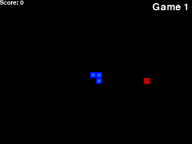

# snake-rl

A small neural network that learns to play Snake from scratch. No rules, no hand-written strategy: it starts by moving at random and figures the game out through reward and punishment.

Built with PyTorch and pygame, using Deep Q-Learning.

<p align="center">
  
</p>

Same agent, one training run: clueless at game 1, still lost at game 50, chasing food by game 80.

## Quick start

You need [uv](https://docs.astral.sh/uv/) and Python 3.12+.

```bash
git clone https://github.com/FBosso/snake-rl.git
cd snake-rl
uv sync
uv run snake-train
```

A game window and a live score chart open. The first ~80 games look hopeless, which is expected. After a hundred or so, the snake starts chasing food on purpose.

Want to play it yourself? `uv run snake-play` and use the arrow keys.

## How it works

**What the snake sees.** Each frame is boiled down to 11 yes/no values:

- is there danger straight ahead, to the right, to the left?
- which way am I moving? (left, right, up, down)
- where is the food? (left, right, above, below)

**What it can do.** Three moves, relative to its heading: go straight, turn right, turn left.

**What it's rewarded for.**

| Event | Reward |
|---|---|
| Eats food | +10 |
| Dies (wall, own tail, or stalling too long) | −10 |
| Any other step | 0 |

Wandering forever doesn't pay either: a game ends if the snake goes too long without eating.

**How it learns.** A two-layer network (11 → 256 → 3) estimates how good each move is. After every step it updates toward the Bellman target `reward + 0.9 × best next move`. After every game it replays a random batch of 1,000 past moves from memory, so it doesn't just learn from whatever happened last.

Early on it picks random moves to explore. That chance shrinks each game and hits zero after game 80.

Whenever it beats its record, the weights are saved to `model/model.pth`.

## Project layout

```
snake_rl/
├── game.py    # Snake environment the agent plays in
├── agent.py   # state encoding, exploration, training loop
├── model.py   # Q-network and training step
├── plot.py    # live score chart
└── play.py    # human-playable version
scripts/
└── record_gif.py  # trains headless and records the GIF above
```

To regenerate the GIF: `uv run python scripts/record_gif.py` (takes a couple of minutes).

## Tweaking

The knobs worth turning are at the top of the files:

- `agent.py`: `MAX_MEMORY`, `BATCH_SIZE`, `LR`, and `gamma` / `epsilon` in `Agent`
- `game.py`: `SPEED` (crank it up to train faster), `BLOCK_SIZE`, rewards in `play_step`

## Credits

Based on the well-known [Patrick Loeber tutorial](https://github.com/patrickloeber/snake-ai-pytorch).

## License

MIT. See [LICENSE](LICENSE).
